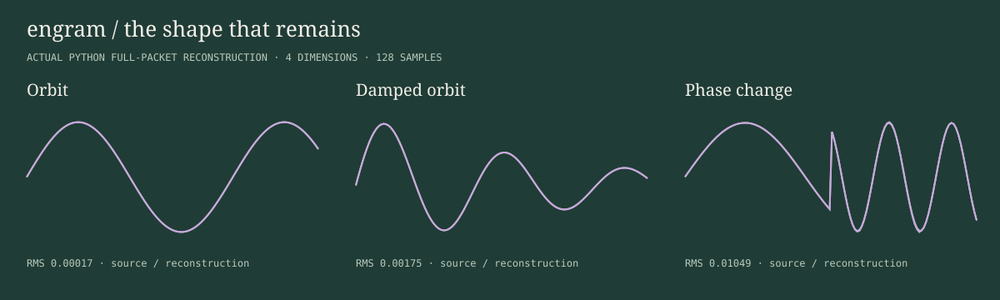
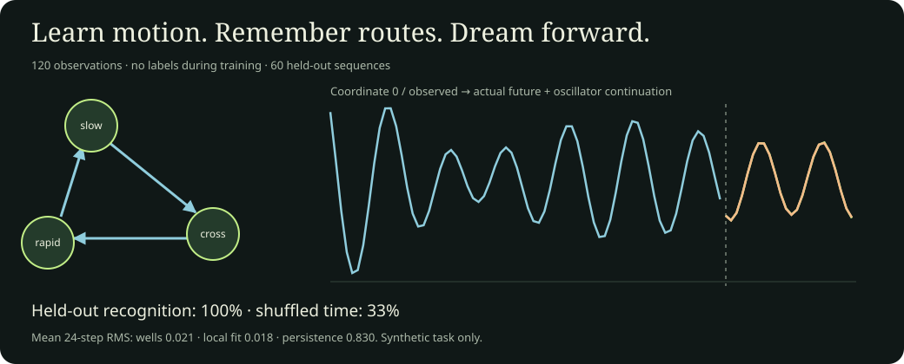

# Engram

**Remember the motion.** Engram is a family of complex oscillators for describing, reconstructing, comparing and remembering trajectories. Its mathematical core is paired second-order dynamics; its memory and generation systems build on that representation.

This repository is the canonical reference for Engram's mathematics, formats and research. Host applications provide coordinate meanings, actions and task-specific interpretation.



## The object

Engram groups real coordinates into complex pairs and models each pair with

```text
z[n] = K · z[n−1] − G · z[n−2]
```

The coefficients describe local motion; two initial values anchor a trajectory. In higher dimensions, independent pairwise fits provide a compact set of dynamical coordinates. Macro and micro layers can describe broad motion and its residual. Prediction error may be retained and quantized for reconstruction.

The hierarchy of the object is:

1. **Representation:** paired coordinates and their units define what a trajectory means.
2. **Dynamics:** fitted oscillator coefficients and initial conditions describe its motion.
3. **Residual:** the difference between prediction and observation records what the chosen model omits.
4. **Packet or memory:** packets preserve reconstruction data; wells summarize observations in a shared coordinate system.
5. **Views and decisions:** temporal summaries, affine forecasts, relational moments and generation expose particular aspects of the stored data. A host may use them for recognition, retrieval, control or action selection.

These levels have distinct contracts. A fitted law does not preserve every chronological fact; a packet is not a learned policy; a named well does not assign meaning to its coefficients. Linear, static, raw and explicit first-order paths cover cases where an oscillator is unsuitable or data is too short.

## Explore

Download the [offline instrument](instrument/engram.html) and open it in a browser. It compares measured library output for five signal families, two dimensions and both runtimes. Inspect blocks, pairings and coefficients, then export CSV, measured JSON or packet bytes. The gallery reads stored cases and works without a server; it does not execute a browser port of the library.

For online learning and continuation, run `python tools/serve_lab.py`. The local well lab trains the Python reference, probes unseen motion, draws learned routes and generates continuations. It can export its measurements and resumable memory. See the [learning guide](docs/reference/LEARNING.md).

## Choose a representation

- **Trajectory input:** ordered finite samples with a positive even coordinate count. Rust accepts flat row-major `[T × D]` values; Python accepts `[T, D]` arrays.
- **Full packet:** fitted coefficients, pairing, initial conditions and residual data for approximate reconstruction.
- **Compact packet:** statistics and coordinate pairing without the omitted reconstruction data.
- **Signature:** K/G coefficients, characteristic roots and residual measurements in a specified basis.
- **Memory measurement:** drift, texture and nearest-well geometry relative to accumulated observations.
- **Generated trajectory:** a Python continuation from parameter histories or learned wells, when the selected model has enough state.

Predictive capture, decoded error and serialized size measure different things. Include metadata in byte counts and compare source against decoded output. For a strict reconstruction limit, Python `Engram(dim=8, max_error=0.001)` or Rust `encode_with_tolerance` checks actual full-packet replay against float32 input and falls back to exact raw samples when needed; that can increase packet size. See the [API](docs/reference/API.md) and [construction](docs/reference/CONSTRUCTION.md).

With no pairing supplied, the encoder selects pairs from absolute co-movement in the trajectory. A supplied pairing preserves a common basis for comparisons and memory accumulation. Hosts own units, sampling cadence, normalization, embedding and recognition thresholds. Engram does not make differently sampled or embedded signals comparable automatically.

`Signature.from_trajectory` includes an explicit AR(1) path for two-row observations. `dynamics` exposes characteristic roots, period and half-life. `ByteHistogram` offers an offline 256-coordinate input over complete byte windows; an external embedding may convey other information, but oscillator regularity alone does not establish semantic understanding. `EmbeddingTable` reads Manifold's GLV1 vocabulary format without bundling its dataset. See [applications](docs/reference/APPLICATIONS.md).

## Remember and continue motion



The Python geometric network learns wells from whole-trajectory K/G/RMS signatures. It can grow wells for unfamiliar motion, retain directed sequence transitions, consolidate observations and continue from a well or graph route. These are inspectable data structures and procedures; they do not provide a general forecast guarantee.

Run `python examples/well_network.py` for held-out recognition and forecasting, or `python tools/serve_lab.py` to inspect the live reference. The [learning guide](docs/reference/LEARNING.md) describes its baselines and failure cases. Rust `Brain` and Python `EngramFile` accumulate observations, but their memory profiles differ: Rust retains K-centered well statistics and bounded history; Python includes fuller histories, routing anchors, graph transitions and generation.

Wells retain sufficient statistics and bounded histories rather than every source packet. Memory grows with the number of wells. Drift and texture are geometry measurements, not calibrated probabilities or task scores. Python dreaming fits additional oscillators to parameter histories and can add residual noise using an explicit NumPy random generator. A dream is an extrapolation to evaluate in its host domain, not a promise of meaningful text, safe control or accurate future observations. See [memory and generation](docs/reference/MEMORY.md).

## Learn experience for an NPC

**“a dynamic creature of learned oscillators”**

An NPC supplies low-dimensional observation or witness vectors over time. Engram summarizes their temporal dynamics, routes contexts to growing experience wells, and learns action responses from observed environmental outcomes. The host defines what observations and actions mean.

Run `python examples/npc_experience.py --training 120 --planning 5` for a delayed-cue navigation task. Identical current junction observations can call for different responses because of earlier cues. The NPC can start blank, load a tailored checkpoint, or use a representation-compatible dynamics prior such as Alexandria; a dynamics prior does not supply task-specific action knowledge.

The optional [Minecraft lane](docs/reference/MINECRAFT-NPC.md) connects the controller to a native villager, movement and collision observations, and block-derived outcomes. The recorded task evaluates learning, temporal ablation, checkpoint transfer and changed consequences in fresh worlds. In that controlled task, learned experience succeeds in 40/40 evaluations versus 18/40 for empty memory and 20/40 with fitted history disabled; after outcome reversal, relearning recovers from 0/40 to 40/40. These results do not establish optimal navigation or general transfer. The plotted observations are schematic, not game screenshots. See [receipts and scope](research/npc/minecraft.json) and the [NPC reference](docs/reference/NPC.md).

Witness calibration, long-history stress and subject-separated human motion results are documented in the [NPC data and stress study](docs/briefs/npc-data-and-stress.md). That study retains simple-statistics baselines, including cases where they outperform oscillator features. The [history reference](docs/reference/HISTORY.md) describes temporal scales and composable ordered summaries. A single fitted law can alias histories relevant to a task; adding summaries must be evaluated against the decisions they are meant to preserve.

## Views of retained evidence

The [construction](docs/reference/CONSTRUCTION.md) derives the views below from
lag statistics, coordinate origins and admissible generation geometry. Each
retains the evidence needed for its operation; their summary types and merge
rules remain explicit.

- **Affine dynamics:** [Affine forecasting](docs/reference/AFFINE.md) fits an explicit intercept, `z[t] = K z[t−1] − G z[t−2] + b`, and retains the offset state required for translated trajectories. Run `python examples/affine_motion.py`.
- **Stable generation:** [Dynamics](docs/reference/DYNAMICS.md) describes strict Schur-coordinate views for blending frozen oscillators. This generation view preserves learned statistics; stability of individual oscillators does not guarantee safe switching or bounded transient gain.
- **Relational moments:** [Relations](docs/reference/RELATIONS.md) retains context-indexed levels and cross-channel moments, with covariance and correlation as views. Run `python examples/relational_wells.py` for conditional evidence and an unknown-context control.
- **History composition:** ordered summaries can be concatenated with boundary corrections without replaying segment interiors. Their fit sufficiency does not imply that every decision-relevant ordering is preserved.

The [relational fidelity study](docs/briefs/relational-memory.md) compares coupling, role-conditioned consequences, temporal probes and topology, including a Minecraft binding control and finite observer checks. It does not claim a general semantic or emotional model. The [history and composition study](docs/briefs/history-and-composition.md) explains integration choices and their proof boundaries.

## Research artifacts and applications

Engram has been used by [Neuron](https://github.com/worflor/neuron) for interaction and rhythm systems, [Manifold](https://github.com/worflor/git-desktop-premium-ultra-promax-plus-R) for code-hunk relationships using Alexandria-backed features, and **What Do You Mean?** for Minecraft memory integration. [Consumer sources and boundaries](integrations/README.md) record their relationship to this repository.

The frozen [Alexandria research artifact](research/artifacts/alexandria.engram) is the 300-dimensional, 225-well memory behind Manifold's bundled export. Its original archive is preserved unchanged; the manifest records 5,518,095 absorptions. See [artifact context and provenance](research/README.md#alexandria-research-artifact). The original training process and corpus are not part of this repository.

Runnable examples cover [Rust trajectory and memory](examples/trajectory.rs), [Python trajectory and memory](examples/trajectory.py), [motion signatures](examples/motion.rs), [text wells](examples/text_memory.py), [parameter-history continuation](examples/continuation.py), [well networks](examples/well_network.py), [byte training](examples/train_bytes.py), [code-hunk retrieval](examples/hunk_search.py), [feedback](examples/feedback.py), and optional [GPU training](examples/gpu_training.py). Commands and expected observations are in [examples/README.md](examples/README.md).

Use cases include gesture and motion signatures, sampled signals and telemetry, text or embedding memory, procedural continuation, and codec or dynamics research. Each depends on a suitable coordinate basis and an external evaluation. The [application guide](docs/reference/APPLICATIONS.md) distinguishes demonstrated integrations from examples and open questions.

## Install

Install from Git; no registry package is published.

### Rust

Rust 1.88+; `num-complex` and Rayon.

```toml
[dependencies]
engram = { git = "https://github.com/worflor/engram.git" }
```

```rust
use engram::{encode::encode, decode::decode, wire};

let samples: Vec<f32> = (0..64)
    .flat_map(|t| [t as f32 * 0.01, t as f32 * 0.02])
    .collect();
let packet = encode(&samples, 64, 2, None);
let bytes = wire::to_wire(&packet);
let restored = wire::from_wire(&bytes).expect("own valid full packet");
let reconstructed = decode(&restored);
assert_eq!(reconstructed.len(), samples.len());
```

For local development, use `engram = { path = "../engram" }`. Registry publication is disabled.

### Python

Python 3.10+ and NumPy. Numba accelerates selected optional research paths.

```sh
python -m pip install "woflo-engram @ git+https://github.com/worflor/engram.git"
```

```python
import numpy as np
from engram_codec import Engram, from_wire, to_wire

samples = np.sin(np.arange(128)[:, None] * .07 + np.arange(4)).astype(np.float32)
codec = Engram(dim=4)
packet = codec.encode(samples)
reconstructed = codec.decode(from_wire(to_wire(packet)))
print(np.sqrt(np.mean((samples - reconstructed)**2)))
```

Python also provides memory archives, generation, trajectory feeds and feedback experiments. It is the broader functional reference; Rust does not implement every Python feature. The distribution is `woflo-engram`; its import is `engram_codec`. See [API and implementation boundaries](docs/reference/API.md).

## Develop and verify

```sh
python -m venv .venv
# Activate .venv using your shell, then:
python -m pip install -e ".[dev]"
python tools/verify.py
npm ci --ignore-scripts
npm test
cargo clippy --all-targets --locked -- -D warnings
cargo package --locked --allow-dirty
python -m pip wheel . --no-deps -w dist
python tools/install_smoke.py
```

Rebuild the explorer with `python tools/build_instrument.py`; rebuild the network figure and receipt with `python tools/build_network_demo.py`. Browser checks need Node 20+ and an installed Chromium-family browser; set `BROWSER_EXE` if automatic discovery does not find it. Optional GPU fitting uses `python -m pip install -e ".[dev,gpu]"` and `python tools/verify.py --gpu`. Research programs have separate dependencies and are not collected by default.

## Reference map

- [Technical design](docs/TDD.md), [research design](docs/RDD.md), [capabilities and limits](docs/STATUS.md).
- [Construction](docs/reference/CONSTRUCTION.md), [API](docs/reference/API.md), [formats](docs/reference/FORMATS.md), [applications](docs/reference/APPLICATIONS.md).
- [Memory and generation](docs/reference/MEMORY.md), [learning](docs/reference/LEARNING.md), [NPCs](docs/reference/NPC.md), [Minecraft lane](docs/reference/MINECRAFT-NPC.md).
- [History](docs/reference/HISTORY.md), [affine forecasting](docs/reference/AFFINE.md), [dynamics](docs/reference/DYNAMICS.md), [relational moments](docs/reference/RELATIONS.md).
- [Research provenance](research/README.md), [historical implementations](legacy/README.md), [consumer integrations](integrations/README.md), [contributor map](AGENTS.md).

Exact component calculations, numerical implementation checks and application experiments establish different kinds of evidence. Scryer findings in [oscillator cases](research/exact/oscillator-cases.json) address selected exact component claims; they do not certify the floating-point codec. No registry package or hosted release is published. Rust retains its [Engram Work Notice and WLCSL-1.0](LICENSE.md); portfolio-derived Python and research sources retain the [Whisper Protocol License](LICENSES/Whisper-Protocol-1.0.md). See [license boundaries](LICENSES/README.md).
