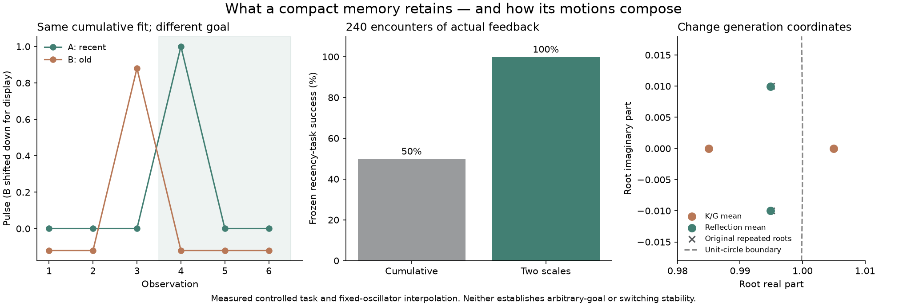

# History composition, temporal adequacy, and stable generation

This study examines how Engram's retained statistics compose, what temporal
distinctions they preserve, and how learned oscillators can be combined while
respecting their stability region. Numerical inputs, source hashes, and finite
results are recorded in the [research receipt](../../research/history-frontiers.json).
The constructions supplement the existing history and dynamics contracts; they
do not certify every NPC policy or every oscillator network.

## Evidence catalog

| Question | Result | Scope |
|---|---|---|
| Can summaries of adjacent streams be joined without replaying their interiors? | Prefix/suffix samples and boundary triples make `WitnessHistory.concat` associative in exact arithmetic, including a fixed decay convention. | Reconstructs fit evidence, not arbitrary online policy updates or whole NPC brains. |
| What temporal information can the fit discard? | Two six-sample pulse histories have equal cumulative fit summaries but differ on a recent-pulse query. A fast/slow bank distinguishes them in the declared task. | No universal sufficient-state claim; the finite observer and task tests have different domains. |
| Can stable oscillators be averaged safely? | Schur/reflection coordinates provide a convex interpolation region for frozen strict-stable oscillators. | Does not guarantee bounded transient gain or arbitrary switching. |
| Can minimum residence repair switching for the audited pair? | A common infinity-norm bound contracts the specific `K=±1.8, G=0.81` pair for residence blocks of at least 43 steps. | Not a universal runtime dwell limit. |
| Can an AR(2) model exactly represent every structured local signal? | A degree-five quintic fixture has zero sixth differences and an AR(2) rank obstruction. | A model-class mismatch fixture, not evidence of unpredictability. |



## Composing ordered history summaries

`WitnessHistory` stores weighted means and centered moments for lagged triples,
along with the first two and last two samples needed to reconstruct triples
crossing a concatenation boundary. For two adjacent segments, at most two new
triples are needed. A fixed decay factor ages earlier evidence consistently.
The resulting operation is associative in exact arithmetic and generally
noncommutative because temporal order changes the boundary triples.

The independent checks cover **8,445 exact cases**: binary streams up to six
samples, every three-way partition, both associations, and decay factors 1,
9/10, and 1/2. **96 floating associations** cover clips up to 1,000 samples at
four decays; the largest direct-fit discrepancy across K, G, and residual RMS is
`3.41e-12`. Unit regressions also cover large offsets, empty and short segments,
decay underflow, operand ownership, and legacy snapshots with unknown prefixes.
These checks use independent rational raw moments for the exact cases and the
production centered-scatter representation for floating cases.

This operation composes fit evidence, not Q values, well-routing decisions,
eligibility traces, or the intermediate updates of an online NPC. Independent
episodes should only be concatenated when a cross-boundary lag is meaningful.
The [history reference](../reference/HISTORY.md) specifies the API and legacy
snapshot behavior.

## Temporal adequacy and finite observers

The exact pulse histories `000100` and `001000` have matching cumulative
first/second lag moments, sample means, and retained endpoints, but disagree on
whether a pulse occurred in the last three observations. The cumulative fit
therefore cannot answer that query from its summary alone.

For the authored response task, a single cumulative history scores **50/100**;
the `(1.0, 0.9)` temporal bank scores **100/100** after 240 training encounters
at each of seeds 7, 19, and 81. The policy receives no explicit pulse-age field.
This establishes the bank's usefulness for that task, not universal recovery of
discarded order or adequacy for every downstream decision.

The finite observer uses 64 six-sample sliding windows, append-0/append-1
actions, and a recent-pulse goal. Scryer 1.0.28 returned the alias pair and a
zero-length distinguishing word for the cumulative candidate. The two-scale
candidate is sufficient for that goal under every finite word of the declared
actions; both returned proof DAGs separately replayed as `kind: valid`. The
candidate distinguishes all 64 windows, while the goal/action quotient has four
classes, so the bank is sufficient but not minimal for this finite task.

The finite source drops its oldest bit on each transition. Production NPC
histories retain cumulative or decayed statistics. The observer does not
certify Python feature generation, floating routing, or an unbounded NPC policy.
Independent repository checks bind feature labels to exact rational fits. The
[observer requests and bindings](../../research/exact/witness-observer-requests.json)
and [deployed construction and replays](../../research/exact/witness-observer.json)
retain the finite model and its proof scope.

## Stable interpolation and switching

For the recurrence `z[n] = K z[n−1] − G z[n−2]`, the Schur/reflection
coordinates map strictly stable quadratic recurrences to a product of open
complex unit disks. Convex interpolation there, followed by the inverse map,
keeps a frozen oscillator strictly stable. The `10,000`-case probe found 522
unstable ordinary coefficient averages in its declared sampling distribution;
all reflection-coordinate blends passed, including float32 output checks. This
rate is specific to that synthetic distribution, not a failure estimate for
Engram data. An edge regression also verifies rejection when rounding pushes an
otherwise interior result outside the requested disk.

The same construction supports an explicit target root radius `ρ`, with
normalization, inverse scaling, post-rounding verification, and mixture-radius
metadata. The requested radius is part of the interpolation geometry; it does
not replace the learned statistics or clip an invalid input. See the
[stability reference](../reference/DYNAMICS.md#strict-stable-generation-coordinates)
for the API, margins, and numeric limits.

Stable individual modes do not guarantee stable arbitrary switching. For the
specific matrices with `K=±9/5, G=81/100`, the repeated-root radius is 0.9, yet
alternating every step produces a two-step growth factor of about 4.721. A
common infinity-norm argument gives a contracting bound at residence boundaries
when each mode remains active for at least 43 updates. It does not bound all
intermediate amplification, other learned matrices, noise, or parameter drift.
The [exact component receipt](../../research/exact/history-composition-cases.json)
retains the confirmed algebra checks and initial routing declines; it is not a
replayed whole-runtime proof DAG.

## Structured model mismatch

The fixture `S(n/16)=10(n/16)^3−15(n/16)^4+6(n/16)^5` has zero sixth finite
differences and an exact six-lag recurrence. Its Hankel matrix has rank 6, while
the homogeneous AR(2) design has rank 2 and the augmented system rank 3. This is
a known structured signal outside one AR(2) model family. It motivates comparing
predictor classes when residuals rise; it does not add a new packet format or
show that an unmodeled signal is unpredictable.

## Compatibility and limits

The cumulative history scale remains the default; legacy `history_decay=`
callers and version-1 NPC memories remain readable. Versioned temporal-bank
snapshots preserve known prefixes and leave missing legacy prefixes unknown.
Wire packets, recurrence sign convention, pair layout, frozen Alexandria bytes,
and the meanings of learned sufficient statistics remain unchanged.

The default NPC controller was exercised in two fresh Minecraft worlds after
the ordered-history implementation. Recorded learning, frozen evaluation,
translated transfer, and outcome reversal matched the prior outcomes; native
semantic trace hashes also matched. This is compatibility evidence for the
default controller. The fast/slow pulse task is a separate deterministic host
experiment, not a new Minecraft result. Sensor recognition, affine forecasting,
and long-stream results likewise remain within their measured task scopes. An
eight-dimensional history stores 1,088 bytes of numeric arrays, plus Python
object/scalar overhead; it does not retain the full past trajectory.

The [history receipt](../../research/history-frontiers.json),
[runner](../../research/experiments/history_frontiers.py),
[history contract](../reference/HISTORY.md), and
[stability derivation](../reference/DYNAMICS.md) contain the measured inputs and
interpretations. The Python runner is offline and does not contact Scryer; live
Scryer responses are retained separately from local numerical checks.

## Open research questions

An oscillator, affine, static, or polynomial predictor bank needs a common
causal likelihood or actual code-length accounting, including parameter and
model-change costs. Raw residuals from differently parameterized fits do not
establish a Bayesian-mixture bound.

Shared consequence prediction requires measured consequence vectors, a declared
context mapping, compatible action semantics, and policy-conditioned estimates.
Each creature still needs its own current history, policy state, and preferences.
Changing a preference over known consequences differs from learning that the
environment itself has changed. Tiercel can contribute spatial measurements
through a host schema, while the validity of its sensing assumptions remains a
host-side question.

## Reproduce

```sh
python examples/temporal_witness.py
python research/experiments/history_frontiers.py
```

Both commands are offline NumPy operations. The research runner writes the
deterministic rational/floating results and finite observer request table; it
does not contact Scryer. The statistical background is Pébay et al.'s
[parallel-moment work](https://www.sandia.gov/research/publications/details/formulas-for-robust-parallel-computation-of-arbitrary-order-arbitrary-varia-2015-02-01/).
Reflection-coordinate stability has a classical
[filter-theory treatment](https://www.dsprelated.com/freebooks/filters/Stability_Revisited.html).
