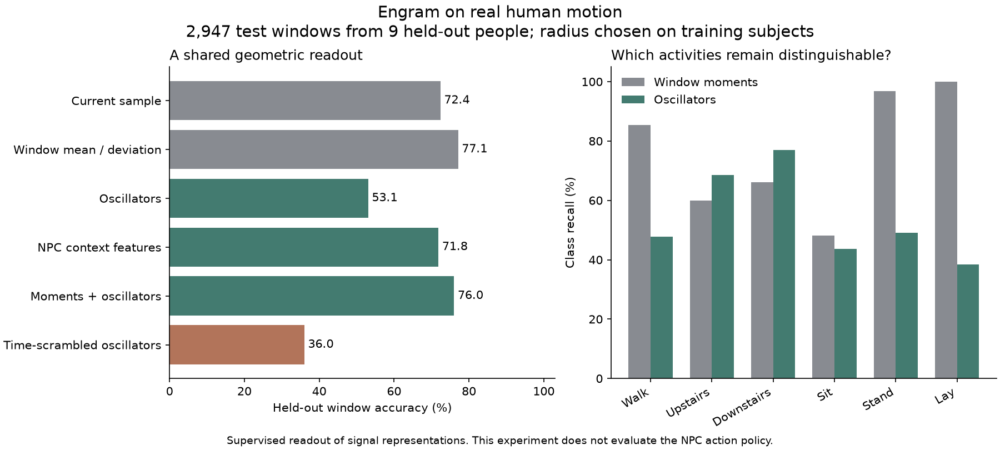

# A dynamic creature of learned oscillators

Engram's NPC is **data-shaped** in a specific sense: observations determine its growing context wells, empirical action outcomes and experience graph. Host actions and outcomes give those structures a task. There is no fixed hidden-layer width or trained language model inside it. The current geometry, pairing, fitting order, novelty radius and learning rule are still explicit modeling choices; they do not discover an adequate representation for every environment automatically.

This study characterizes training-stream witness calibration, deterministic continuation and temporal representation on real recordings. The [numeric stress receipt](../../research/npc/stress.json) and [real-data receipt](../../research/npc/real-signals.json) preserve source identities, parameters and results. The separate [Minecraft experiment](../reference/MINECRAFT-NPC.md) evaluates action learning in a native environment.

## Let observations establish their units

`WitnessSchema.calibrate(channels, training_observations, representation=...)` estimates means and population deviations using streaming centered updates and O(D) storage. These become the fixed schema offsets and scales. Constant channels use one host unit; `minimum_scales` can express per-channel sensor noise or a meaningful minimum unit.

```python
schema = WitnessSchema.calibrate(
    ('distance', 'sound', 'temperature'), training_observations,
    representation='habitat-senses-v1', minimum_scales=(0.1, 0.01, 0.1),
)
npc = EngramNPC(schema, seed=7)
```

Calibrate from training observations, then freeze the schema. Test subjects, future episodes and labels do not participate. Never refit scales under accumulated wells: changing coordinates changes the meaning of old experience. An explicit sensor floor is useful when an almost constant training channel might otherwise magnify tiny fluctuations. This normalization is sensitive to outliers; it is not a robust estimator or a missing-data imputer. Hosts still own channel meanings, sampling cadence and observation quality.

The tests check known population statistics, positive unit conversions, constant channels, bad inputs, fixed evaluation coordinates and exact checkpoint restoration.

## Real human motion

We use the [UCI Human Activity Recognition Using Smartphones dataset](https://archive.ics.uci.edu/dataset/240/humanactivityrecognitionusingsmartphones), by Reyes-Ortiz, Anguita, Ghio, Oneto and Parra, DOI [10.24432/C54S4K](https://doi.org/10.24432/C54S4K), under CC BY 4.0. It contains six activities recorded with a waist-mounted smartphone. We use its nine preprocessed inertial channels at 50 Hz, in the provided 128-frame windows. These are measured recordings, not synthetic oscillator traces. The source is already filtered and windowed; it is not the later raw continuous-recording dataset.

The official split contains 7,352 training windows from 21 people and 2,947 test windows from nine different people. Overlapping windows stay within their subject partition. Validation subjects `[1, 8, 17, 25, 30]` come only from the training split. Each representation chooses a well radius from `[0.35, 0.6, 0.9, 1.2]` by validation balanced accuracy. After that choice it refits on all training subjects. Both witness units and the readout's feature scales are fitted on training data only.

Each independent window is centered and fitted with the canonical AR(2) routine in a fixed pairing, with one explicit zero companion channel. Windows are never concatenated into a fictional continuous trajectory. A streaming NPC history on the first window agrees with the batch route. A simple supervised readout grows radius-based feature wells and annotates them with class counts after routing. The label never enters the witness or creates a well. At test time the nearest frozen well predicts its most frequent training class. This readout measures representation quality; it is not the NPC's reward-learning policy or a comparison against a modern activity-recognition model.

| Representation | Test accuracy | Balanced accuracy | Learned wells |
|---|---:|---:|---:|
| Current sample | 72.38% | 71.03% | 2,338 |
| Window means and deviations | 77.10% | 76.07% | 1,591 |
| K/G/log residual | 53.07% | 54.05% | 2,458 |
| Current sample plus oscillator features, as in NPC context | 71.84% | 71.30% | 4,454 |
| Window moments plus oscillator features | 76.01% | 75.69% | 3,512 |
| Oscillators after time scrambling | 36.00% | 35.95% | 3,515 |



Time scrambling applies one permutation to all channels within each window, preserving their sample distribution and cross-channel alignment while destroying temporal order. Its degradation supports the presence of useful temporal information in the fitted coefficients on this task. The stronger moments baseline and the combined representation's lower accuracy show that adding oscillator features does not automatically improve recognition. The original dataset also supplies a richer engineered feature set; this campaign does not benchmark that set or claim a competitive leaderboard result.

All six declared comparisons are retained. The receipt includes confusion matrices, per-subject results, validation candidates, selected radii and prediction hashes. Windows from one person are correlated, so a window-wise confidence interval would overstate independent evidence; nine held-out people remain a limited generalization sample. The small radius selected for five representations also produces thousands of wells. This is useful evidence about representation and geometric sparsity, not an argument that more wells alone solve the task.

Before history extraction, a second complete run on the same Windows/NumPy runtime reproduced the report byte for byte, including every prediction hash. A later run with the extracted history core and expanded source inventory retained all six prediction hashes, metrics and validation choices. The report identity and byte-repeat scope are recorded in `research/validation.json`; the original run predates the public source snapshot. Neither check establishes bitwise agreement across numerical libraries or platforms.

For an NPC, preserve host observations that matter: orientation, levels, contact, phase and task-relevant events can complement temporal dynamics. The delayed-cue Minecraft task establishes a case where history matters; it does not imply that AR(2) coefficients alone are sufficient for human motion, language or every game's state.

## Deterministic and numerical stress

- **Checkpoint continuation:** 1,000 ordered feedback steps, 3,000 planning updates and an interruption at step 333. Restored and uninterrupted agents make the same decisions and finish with identical canonical policy, RNG and history state.
- **Process reproducibility:** independent Python processes with hash seeds `1` and `987654`, unordered host action sets and reversed action enumeration produce identical decision and canonical-state hashes. This establishes repeatability for the recorded inputs, seed and numerical runtime. It does not establish order-independent learning or bitwise equality across platforms.
- **Long histories:** three 100,000-sample, eight-dimensional streams, including offsets of magnitude one million, at history decays `1`, `0.995` and `0.5`. Independent weighted normal equations agree within `2.55e-11` over K, G and residual RMS. Each history retains two prefix rows, two previous rows and 1,088 bytes of numeric arrays, plus Python object/scalar overhead. The experiment retains source input arrays for its independent check; whole-process memory is not constant.
- **Growing state:** 2,048 deliberately distinct contexts and a further feedback context produce 2,049 wells; the host offers 4,096 action IDs. The complete state survives save/load. This exercises vocabulary and state growth, not mastery of thousands of actions. Only one actual feedback event is supplied in this growth test.
- **Planning against an analytical value:** a one-state self-loop with reward 1 and discount 0.95 has value 20. Twenty actual observations of the transition followed by 4,000 planning updates give `19.999999999999815`. Planning leaves observation mass and real visit counts unchanged.
- **Corrupt snapshots:** loading rejects mismatched well inventories, transition/visit mass, total update counts and malformed action IDs. Existing per-field finite/basis/schema checks remain in force. Floating reward totals are not equated by regrouping sums: cancellation can change their rounding.

The growing-state run took about 15 seconds on this Windows host under concurrent work and wrote a roughly 5 MB checkpoint. This is a measured cost, not a throughput guarantee. Routing still scans all wells, and model/checkpoint memory grows with learned geometry and transitions. There are no fixed NPC caps hiding those costs. Scaling should be measured before choosing an index, consolidation rule or retention policy; each could change what the creature remembers.

## Reproduce

```sh
python research/experiments/npc_stress.py
python research/experiments/npc_real_signals.py --download --cache cache/uci-har
python tools/build_npc_research.py
```

The first two require NumPy and the reference module. Only `--download` authorizes this runner to fetch a missing dataset; an existing cache is hash-checked every run. The roughly 61 MB outer archive contains the original dataset ZIP. Expected SHA-256: `c00b803081a5c797cd5e4b83700a9810b38d53d9d84e01917e090e1fdbc81031`. No archive entries are extracted to paths or executed. The figure builder additionally requires matplotlib. Corpora, trained readouts, working memories and machine-specific paths remain outside the repository.

The stress runner exposes finite campaign sizes as command-line options. They are experiment budgets, not library limits. Keep the recorded source identities with a result; rerun after changing the model or experiment.
