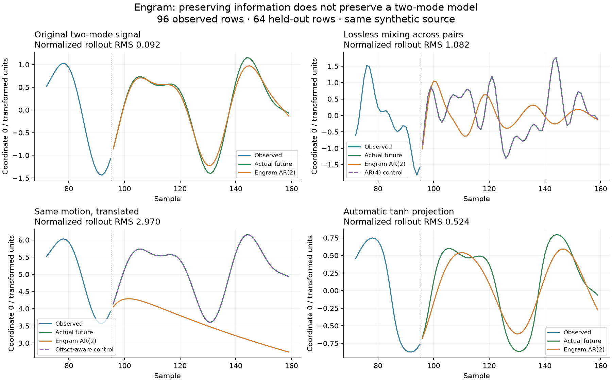

# Projection and continuation: what the object preserves

This synthetic study, performed 2026-10-15, tests whether projection and coordinate changes preserve Engram's AR(2) structure. No production algorithm was changed. The examples are finite and deliberately discriminating; they do not establish corpus or language quality. Existing tests validate contracts, not general forecasting competence.



## Main finding

Engram's paired complex AR(2) model has a specific geometry. A projection can preserve all information in the signal while destroying the assumption that each pair contains at most two exponential modes. Good reconstruction, a good one-step fit, a good long continuation and stable operations on wells are separate properties.

The earlier well-network demo generates exactly the sort of two-mode signal this model fits. Its held-out phases/amplitudes are useful, but do not test general coordinate changes or arbitrary motion. A bad graph-guided continuation can also be intentional movement to a different learned oscillator rather than a forecast of the original signal.

## Coordinate changes have different effects

Multiplying a complex pair by the same nonzero complex constant preserves its recurrence. The rotation/scale control has the same normalized rollout error as the original (0.0923); its doubled absolute error reflects doubled signal amplitude.

Mixing pairs with different dynamics is different. In the study, an invertible orthogonal transform combines two complex pairs, each with two modes. Each new pair can now contain four modes. No input information was lost, but the model class changed:

| Same synthetic source, 96 observed / 64 future rows | Reference rollout RMS | Unregularized AR(2) RMS | AR(4) RMS | AR(2) with offset RMS |
|---|---:|---:|---:|---:|
| Original coordinates | 0.0679 | <0.000001 | <0.000001 | <0.000001 |
| Lossless mixing across pairs | 0.7961 | 0.7969 | <0.000002 | 0.7979 |
| Translated coordinates | 2.1853 | 2.2007 | <0.000002 | <0.000001 |
| Automatic tanh projection | 0.2816 | 0.2738 | 0.1103 | 0.2845 |

The least-squares baselines are research controls, not production replacements. The clean original's reference error also exposes ridge bias: regularization changes fitted dynamics, and that small change compounds during a rollout. Removing regularization is not automatically better on noisy or poorly conditioned inputs.

## Translation exposes the missing offset term

For `y = z + c`, the recurrence becomes:

```text
y[n] = K y[n−1] − G y[n−2] + c(1 − K + G)
```

A homogeneous model generally needs either a suitable origin or an explicit affine term. This is not an algebra error in Engram's stated recurrence. It is a limitation when a caller expects translated motion to work automatically.

On 30 held-out observations from the existing network fixture, shifting every coordinate by +2 increased mean 24-step well forecast RMS from **0.0212 to 2.4028**. Persistence was 0.8507 in either case. A separately fitted affine AR(2) control stayed near 0.0101. Recognition remained 29/30 after translation: identifying roughly similar dynamics did not imply an accurate positional continuation.

## Tanh does not preserve a two-mode signal

`TanhProjection` bounds coordinates and calibrates their median magnitude. It does not optimize temporal model fit. A nonlinear warp generally adds modes/harmonics.

An exact finite counterexample uses `x[n] = n log(2)`, a linear AR(2) trajectory, and `y[n] = tanh(x[n])`:

```text
y[0..4] = 0, 3/5, 15/17, 63/65, 255/257
```

The equations for a constant K/G over these samples have a coefficient matrix of rank 2 and an augmented matrix of rank 3. They are inconsistent, even allowing complex K/G. Scryer confirmed those ranks and the nonzero augmented determinant `−1469664/82071665`. This is a counterexample to universal recurrence preservation, not a claim that every tanh-projected signal forecasts poorly.

On the numerical fixture, normalized rollout RMS was 0.0923 before projection, 0.0938 for weak tanh, 0.5241 for automatic tanh, and 0.9329 for strong tanh. Normalization matters: weak tanh shrinks absolute error along with the signal.

The projection docstring is stale: it describes a 0.485/0.45 calibration and an unqualified 85% gradient-zone figure; the implementation uses `atanh(.5)` and median scaling. A sample containing 49% zeros, 2% ones and 49% one-million values leaves only **2%** of projected values between magnitudes 0.1 and 0.9. An all-zero calibration sample also chooses a huge scale, saturating a subsequent 0.001 input to 1. These are calibration/design limitations; tanh itself is being evaluated correctly.

## Stable wells do not make every operation stable

**Coefficient averaging:** let the two wells have repeated roots `r = 199/200 ± i/100`. Each has radius about 0.99505. Their K/G feature distance is only 0.05643, below the network's default novelty radius. Their coefficient mean has roots **201/200 and 197/200**; the first grows. Scryer derived the mean's exact roots. The current `learn_signature` boundary admits this case and automatically puts both observations in one well, reproducing radius 1.005.

That numerical reproduction supplies exact analytic features to the supported feature-input boundary. It is not evidence that ordinary trajectory fitting commonly produces this case. A separate grid of **330 ridge-fitted** signal/conjugate pairs found no such nearby unstable average. The exact counterexample invalidates a universal guarantee; the negative grid search limits any claim about practical frequency.

**Switching:** the real companion matrices for `(K,G) = (9/5,81/100)` and `(-9/5,81/100)` each have repeated root radius 0.9. Alternating them has a two-step transition eigenvalue `(-243−162√2)/100`, of magnitude about **4.721**. Individual radius clipping at 0.999 would not alter either oscillator. Thus per-node root bounds do not guarantee a bounded graph walk. This is a constructed control example, not a measured explosion of the default demo's wells.

**Transients:** even one repeated root at 0.99 can amplify seeds before decaying. The `z[-1]=0, z[0]=1` response reaches about 36.97. Root radius describes asymptotic exponential behavior, not a maximum gain.

In the actual lab fixture, staying in the selected well gave RMS 0.0064 on one probe; switching every four samples gave 1.2260. The latter deliberately changes oscillators and should be assessed as procedural generation rather than a forecast of an unchanged source.

## Open experiments

1. Compare explicit offsets/centering and adaptive order against the present fixed homogeneous AR(2), using noise, drift and distribution shifts as well as matched synthetic signals.
2. Evaluate projections by retained dynamical predictability and conditioning, alongside dimensional reduction or activation spread. Preserve within-pair symmetries where useful; do not expect arbitrary rotations to preserve the pairwise model.
3. Treat centroid formation and graph transitions as dynamical operations needing their own stability/transient analysis. Averages, root clipping and arbitrary switching are not interchangeable safety guarantees.
4. Keep parameter-space descriptors distinct from spatial positions. Well-guided byte-coordinate refinement remains a proposal requiring retraining and held-out comparison; this study does not validate that refinement process.

## Reproduce and inspect

```sh
python research/experiments/projection_audit.py
# Optional figure, after installing matplotlib in the research environment:
python research/experiments/projection_audit.py --plot
```

[Numerical receipt](../../research/projection-audit.json) includes inputs, forecasts, controls, source hashes and the bounded search. [Exact receipt](../../research/exact/projection-cases.json) retains nine live studies and eight confirmed checks through invocation-reported **Scryer 1.0.28**. Unrelated integer-lattice readings were declined for rational matrices; they were not interpreted as failures of the relevant findings. The stability interpretations above combine the engine's exact matrix results with the displayed elementary algebra. No proof DAG was returned/replayed, and no whole-implementation certification is claimed.
