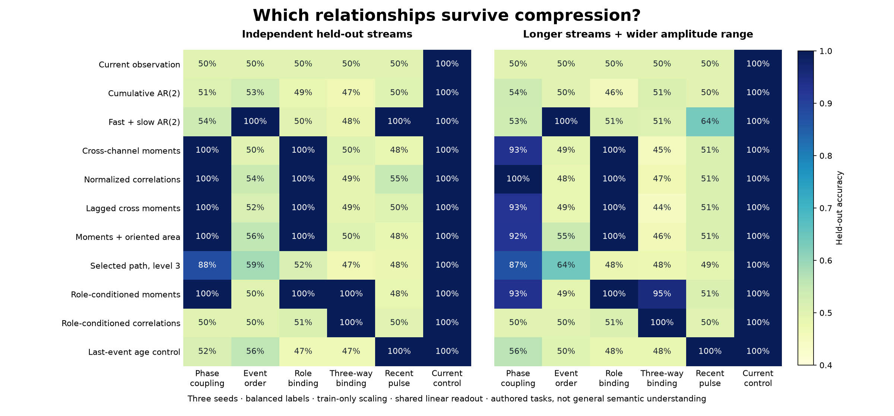

# Relational fidelity: moments, fibers, paths and topology

This study asks which distinctions an Engram host must retain to make a particular
decision. It does not equate a named well with a semantic concept. The studied
representation augments oscillator memory with explicit relational evidence:
what varied together, which entity or context it belonged to, and what followed.

The studies leave codec, well centroids and NPC checkpoints unchanged. The
streaming `ContextRelations` companion documented in
[the relational reference](../reference/RELATIONS.md) retains selected
context-conditioned moments without changing oscillator routing, packet formats,
or existing memory archives.

## Controlled representation campaign

[The runner](../../research/experiments/relational_memory.py) compares eleven
representations on six authored eight-channel tasks. Every representation uses
the same linear outcome readout, training-only feature scaling, and ridge grid
selected on validation data. Per task and seed: 96 training streams, 48 validation
streams, and 96 tests under each of two conditions. The second condition has
longer streams and a wider amplitude range. Labels are balanced and stay outside
the input. Observed role is a channel; the answer is not a role key.

The exploratory [campaign](../../research/relational-memory.json) uses seeds
7, 19 and 81: **38,016 model decisions on 6,048 streams containing 250,645 rows**.
Some representations were selected after preliminary results, so this campaign
is exploratory rather than a preregistered discovery claim. An independent
[confirmation campaign](../../research/relational-confirmation.json) uses fresh
seeds 211, 307 and 419 without changing the representation or readout protocol.
Together the retained campaigns contain **76,032 model decisions on 12,096
streams and 500,549 observation rows**. These counts include multiple readouts
of the same streams; they are not independent environment encounters.

The representations are current observation; cumulative AR(2); cumulative/0.9
temporal fits; means, deviations and cross-channel covariance; normalized
correlations; directed one-step lag moments; covariance plus signed path area;
selected two-coordinate level-3 path signatures; role-conditioned moments;
role-conditioned correlations; and a deliberately simple last-event/age control.

The original campaign's longer/rescaled condition gives:

| Distinction | Useful representation | Accuracy | Relevant comparison |
|---|---|---:|---|
| Same versus opposite complex motion | Normalized cross-channel correlations | 100% | Cumulative AR(2): 53.8%; raw moments: 93.1% |
| Which role an outcome belonged to | Cross-channel correlations | 100% | Cumulative AR(2): 45.8% |
| Role × cue × consequence binding | Role-conditioned correlations | 100% | Pooled correlations: 47.2%; unnormalized fibers: 95.1% |
| Which separated pulse occurred first | Fast/slow temporal bank | 100% | Selected level-3 geometric path: 64.2% |
| Whether a pulse was recent | Explicit last-event/age control | 100% | Temporal bank plus linear readout: 63.5% |
| Answer visible in current observation | Current observation | 100% | Additional memory is unnecessary here |

Each entry pools 288 independently generated test streams, with per-seed results
retained. Accuracy tests this particular readout, not all decisions that could
possibly be extracted from a feature. A failed readout does not prove two
representations mathematically identical. Exact collision tests provide the
stronger conclusions where available.

The fresh-seed confirmation retains 100% at every seed and both test conditions
for normalized phase coupling, normalized role binding and normalized
role-conditioned parity. The event-order temporal bank and explicit recent-event
control also retain 100%. The temporal-bank recency readout again fails to fully
transfer: **59.7%** under longer/rescaled inputs, versus 100% in-distribution.
This repeats the boundary rather than establishing a general-purpose winner.

The phase pair has identical independent oscillator fits but opposite measured
cross-channel covariance. The parity construction balances all four role/cue
groups; pooled first/second moments agree between its two labels, while
conditional cross moments differ. The tests caught an early fixture error where
replacing its last event broke that balance; the retained campaigns append a
common zero endpoint instead. The known six-sample pulse collision is also
checked independently of the campaign generator.



Feature storage is reported in each receipt, separately from learned readout
storage. The harness retains full trajectories during extraction. Dense feature
size is **not** a measurement of an optimized streaming implementation, lookup
latency, or total NPC memory. This study does not establish a speedup over Pets
Plus or select an overall winner by averaging unrelated tasks.

## Fibers have an operational meaning

Here a fiber is a separate statistical summary over observations with the same
declared role/context. It is not a certified geometric fiber bundle. Conditioning
preserves a relationship that pooling can cancel: opposite cue/outcome
correlations in two contexts have zero pooled correlation.

Its boundaries matter. The normalized fiber view discards levels, so it performs
poorly when a constant outcome within each role is the relevant evidence. The
ordinary moment view retains that information. Normalization is an explicit
derived view, not permission to change the coordinates of accumulated wells.
Unknown contexts need a declared fallback or abstention; normalized affinity is
not calibrated confidence.

The root design candidate is therefore **levels + selected normalized coupling +
temporal evidence + conditional consequences**, with a fixed schema and stable
role/action identities. It is not a replacement of all state by correlations.
Named emotional categories could bind several learned response wells while
retaining differences among startle, vigilance and recovery.

## What the topology probes establish

[Exact path and braid probes](../../research/relational-topology.json) use the
[classical signature construction](https://arxiv.org/abs/1603.03788): segment
tensor exponentials compose by Chen's identity. Two fixed lattice paths have
the same endpoint and complete level-2 signature, including signed area, but
different level-3 coordinates. A finite truncation deliberately loses further
information. Without a time channel, geometric signatures also discard duration
and retracing information. Separated excursions can return along the same axes;
their event timing is not automatically preserved by geometric shape.

For three-strand braids, the supplied integer matrices are
`A=[[1,1],[0,1]]` and `B=[[1,0],[-1,1]]`. They obey `ABA=BAB` and inverse
cancellation. An initial positive/negative-word task is solved by exponent sum
alone; its report explicitly retains that stronger simple control.

The more discriminating task compares `AABB` with `ABBA`. They have the same
permutation, signed generator counts and exponent sum, but different matrices.
Across 1,000 matched pairs with random inverse insertions, exact matrix-prototype
recognition is 100%; those count/permutation controls are necessarily at 50%.
Another 2,000 words exercise braid-relation rewrites. This is recognition of
authored algebraic equivalence, not learned semantics. A raw ordered word also
preserves the distinction. This specialization is not faithful: `(AB)^6=I`
although the word has exponent sum 12. See the
[braid survey](https://www.math.columbia.edu/~jb/Handbook-21.pdf) for classical
representation context; the finite identities here are independently checked.

[Closed polygon probes](../../research/relational-links.json) compute the linking
number from exact rational mixed-component crossings. A linked pair gives -1,
separating the loops gives 0, and reversing one orientation gives +1. Sixty-four
common positive rational scale/translation transformations and an edge subdivision
preserve the result. Degenerate projections reject. This is the classical
[signed-crossing construction](https://web.math.princeton.edu/~petero/GridHomologyBook.pdf).
It concerns **two closed curves**, not knot classification or arbitrary open
emotion histories. Closure and identity conventions can discard exactly the
information an NPC needs. No knot invariant was installed in the Engram core.

## Exact observer versus empirical learning

[Deployed Scryer evidence](../../research/exact/relational-observer.json) uses the
invocation-reported engine 1.0.28. The finite source consists of eight sign triples
and three actions that flip one coordinate; its goal is triple parity. Pairwise
products cannot distinguish a triple from its complete sign reversal, although
their goals differ. Scryer returns that separating pair. The parity observation
preserves the goal under every permitted action and gives a two-class quotient.
Both returned DAGs were separately replayed with `verify`: **valid**.

This establishes adequacy for that declared finite source, not for an arbitrary
Minecraft world, the Python feature extractor, or learned labels. Three scalar
component checks were confirmed. A six-variable conditional rotation claim was
refused by the deployed real-algebra route; its unconditional polynomial
factorization was then confirmed, allowing the unit-rotation specialization by
ordinary substitution. The receipt preserves the refusal and retry separately.

## Grounded Minecraft binding control

[The opt-in runner](../../research/experiments/relational_minecraft.py) uses the
existing isolated native Minecraft lane, without changing its Java world logic.
The retained [receipt](../../research/relational-minecraft.json) and actual
[JUnit verdict](../../research/exact/relational-minecraft.xml) record 112 encounters:
16 measured training encounters and 96 frozen model-driven evaluations,
784 behavioral acknowledgements and 560 native moves in a fresh JVM/world.

The host explicitly retains the observed wool cue until the cue-hidden junction.
Three empirical tables using root `ContextRelations` learn only from actual
terminal feedback: pooled action outcomes, cue/action fibers, and deliberately
inverted cue bindings. Their frozen
default and translated-world successes are respectively 4/8, 8/8 and 0/8.
After emerald/magma floors reverse, the original fiber succeeds 0/8. Fresh tables
trained on eight reversed-map encounters recover 8/8. This is fresh relearning,
not an online forgetting result. The source-bound receipt records seed 81, the
run identity, source hashes, native capture digest and JUnit verdict.

This control demonstrates the value of preserving a conditional consequence.
It evaluates explicit context/action tables, not the EngramNPC learning policy,
latent-context discovery, a Pets Plus integration, or large-population
performance. The existing NPC's separate
[game evidence](../../research/npc/minecraft.json) remains unchanged.

## Streaming parity and adversarial binding

Role binding and three-way parity are **different target tasks**. A normalized fiber
can lose constant within-role levels while retaining a cue/consequence
correlation. Neither task establishes a universal hierarchy of concepts.

The [conditional-binding runner](../../research/experiments/conditional_binding.py)
uses the root `ContextRelations` object. Each context keeps count, mean and
centered scatter; normalization is a derived view. In the exact balanced binary construction,
`outcome = label * role * cue`. Every one- and two-coordinate probability law
is identical for the two labels, while all three coordinates determine the
label. Thus target mutual information is zero for any one or two coordinates
and one bit for the full triple. This is a classical parity construction related
to [synergistic information](https://arxiv.org/abs/1004.2515), not a novel
decomposition theorem or an estimated partial-information decomposition.

Within a role, `E[cue*outcome | role] = label*role`. The conditional second moment
therefore exposes the interaction. An explicit triple-product statistic also
solves the clean case; fibers are not uniquely capable of doing so.

[Eight seeds](../../research/conditional-binding.json) evaluate 6,144 streams
and 30,720 declared algebraic readout decisions, with 128 rows per stream:

| Condition | Conditional correlation | Useful boundary/control |
|---|---:|---|
| Clean, changed positive channel units, per-role offsets | 100% | Pooled pairwise relation cannot solve the balanced clean parity task |
| Per-role offsets plus unequal role frequency | 100% | Global-centered triple product: 50% |
| Gaussian noise at one signal standard deviation | 100% | Finite-sample result, not a noise guarantee |
| Gaussian noise at twice signal standard deviation | 98.6% | Errors remain visible |
| 10% randomly incorrect role assignments | 100% | Enough aggregate evidence in this finite sample |
| 50% randomly incorrect role assignments | 50% | Binding corruption destroys the useful association |
| Every role assignment inverted | 0% | The frozen role convention reverses the answer |
| Both role identifiers unseen | No covered decisions | Required familiar contexts are absent; the probe abstains |

These are algebraic decoders of authored distributions, not trained NPC
policies. Role imbalance breaks the balanced marginal symmetry, so
the exact zero-information statements should not be generalized to every stress
condition. No calibrated probability or semantic meaning is inferred from a
correlation value.

The two-context mean/scatter numeric payload is 96 bytes, excluding Python
objects, context keys, integer counters and snapshot copies. The observations
are not retained by the root object. Sixteen-row chunk merges differ from direct
streaming covariance by at most 1.43e-14 in the measured controls, and JSON
roundtrips preserve scatter exactly. This is actual streaming compression of the
tested sufficient statistics, not a full history or a world-model compression
ratio. Full covariance storage remains O(C D²).

An exact companion control shows the complementary failure: two memories have
equal correlation views but opposite constant consequence means. Their full
root summaries retain the difference. The proper response is to preserve the
statistics and choose the view appropriate to the question.

The stronger negative control uses four-way parity
`outcome = label * role * a * b`. Even **full** first/second moments of
`(a,b,outcome)` within each role are identical for both labels: zero means and
identity covariance. That information really is absent from this summary;
another readout cannot restore it. Conditioning additionally on `a` exposes
the needed `(b,outcome)` relation. The exact integer witness is retained in the
receipt. This establishes a targeted refinement, not an automatic discovery
algorithm or universal sufficiency of contextual covariance.

[Three further Scryer component checks](../../research/exact/relation-moments.json)
confirm the centered-moment merge identity, an affine covariance factorization,
and a nuisance term in globally centered triple products. For role mean `m`
and common role-dependent offset `b`, the latter probe contains
`label + b²*(m³-m)`; that extra term can swamp the answer. These are algebraic
components, not a certificate for all floating-point module behavior.

## Retention versus accessibility in the temporal bank

[A separate six-seed readout study](../../research/recency-decoding.json) reuses
exactly the recent-pulse streams, split boundaries and bank features from the
original/confirmation campaigns. It adds neither event age nor sample count to
the input. Hyperparameters and units are selected from training/validation only.
On the longer/rescaled inputs (576 tests per head):

| Readout | Accuracy |
|---|---:|
| Existing linear head | 61.6% |
| Gaussian RBF kernel ridge on the same bank | 88.9% |
| Linear head plus a derived fast/slow RMS ratio | 57.3% |
| RBF plus that ratio | 65.5% |

All four reach 100% on their independent in-distribution test. The RBF result
demonstrates that substantially more useful information is accessible from the
same retained bank than the tested linear head extracts. It does not prove the
bank sufficient for every recency query. The RBF retains 96 training prototypes
and costs more storage and query work: **38,424 numeric bytes versus 1,160** for
the linear head in this experiment. It is not installed as the NPC's default
response rule. Appending a deterministic ratio adds no information and still
changes model geometry enough to hurt this held-out result. The report retains
per-seed selected parameters, numeric readout sizes and prediction hashes.

## Consequences for an emotion system

The [Pets Plus source at `c0175ede`](https://github.com/worflor/woflo-petsplus-mod/tree/c0175ede467e9710c5c889410c25840134f94d21)
contains an authored appraisal engine. Its emotion records, habituation,
context-dependent decay, and mood-to-goal rules supply useful baselines. Its
synchronous entity queries and environment scans are separate work; source
inspection does not diagnose the reported lag. Pets Plus was neither modified
nor profiled for this study.

An object-like implementation could update relation statistics only when evidence
arrives and project response scores from that materialized state when queried.
For immediate consequence features, a conditional running mean supports
`expected_utility = preferences · mean_consequences`. This preserves a distinction
between learned outcomes and current motives. It does not supply long-horizon
successor features, discover an unknown reward convention, or eliminate current
world sensing. Frozen predictions must become uncertain or change when new
evidence contradicts them.

An emotion-system integration should keep the learned sufficient statistics,
provide explicit relational views, test schema/identity compatibility, and
compare event-driven updates with the appraisal baseline under a profiled pet
population. Sensor noise, missing observations, unseen roles, and long-lived
changing consequences remain untested. Current evidence supports conditional
relational statistics and temporal probes for their declared tasks. Paths,
braids, and links are useful only where the host can state which order or
topology a decision must preserve.

## Reproduce

```sh
python research/experiments/relational_memory.py
python research/experiments/relational_topology.py
python research/experiments/relational_links.py
python research/experiments/conditional_binding.py
python research/experiments/recency_decoding.py
python -m pytest tests/research -q -W error
python tools/build_relational_demo.py
python research/experiments/relational_minecraft.py --work <scratch> --heavy-lock <shared-lock> --java <jdk25-java>
```

The confirmation uses `campaign(seeds=(211,307,419))` with the same default split
sizes and writes `research/relational-confirmation.json`. Algebra/topology probes
use the standard library; numerical experiments need NumPy and the figure needs
matplotlib. The Minecraft command owns only its isolated process tree and takes
the machine's shared heavy-build lock. Live Scryer requests and responses are
retained; connection configuration and operational client helpers are excluded.
