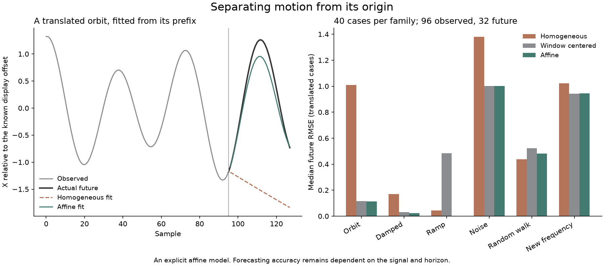

# Motion with an explicit origin

`engram_affine.AffineOscillator` fits and forecasts a paired complex recurrence with an unpenalized intercept:

```text
z[t] = K z[t−1] − G z[t−2] + b
```

This is an explicit analysis/forecasting option alongside Engram's homogeneous AR(2) packet contract. It preserves a distinction between the dynamics and their coordinate origin. It does not change V4, silently change learned wells, or replace the NPC response policy.

## Coordinate translation

Let `u[t] = z[t] + c`, where c is a fixed complex translation. Substitution gives:

```text
u[t] = K u[t−1] − G u[t−2] + b + c(1 − K + G)
```

K and G remain the same; the intercept becomes `b′ = b + c(1−K+G)`. A homogeneous recurrence has b=0. Unless `c(1−K+G)=0`, translating its trajectory generally leaves that model family. Adjusting homogeneous K/G does not always recover an exact fit.

A finite rational counterexample starts from `K=3/5`, `G=9/25`, seeds 1 and 0. Its next values are `−9/25`, `−27/125`, 0 and `243/3125`. Translate every value by 7. The correct intercept is `133/25`. The three-column affine design has rank 3 and determinant `−171/625`. The two-column homogeneous design has rank 2, while appending the target raises its rank to 3: no homogeneous K/G fits those same three observations exactly.

The deployed Stithy Scryer **1.0.28** returned these ranks/determinants and confirmed five exact component claims. It also confirmed the universally quantified real polynomial translation identity, normalized to zero nonzero terms. The complex version follows by the same commutative polynomial expansion. [Requests, studies, declines and six confirmed checks](../../research/exact/affine-cases.json) are retained. The rational matrices' integer-lattice readings were declined, as expected. No proof DAG was replayed; these are exact mathematical components, not certification of the floating-point implementation.

## Fit the intercept without penalizing it

For the observed triples, write `Y=z[t]`, `A=z[t−1]` and `B=z[t−2]`. The objective is:

```text
sum w[t] |Y − K A + G B − b|² + ridge (|K|² + |G|²)
```

For fixed K/G, minimizing over b gives `b = mean(Y) − K mean(A) + G mean(B)`. Substitute that expression and solve the two-column problem with **each lag column centered by its own mean**. In general those means differ. Subtracting one whole-window mean from every column and forcing b=0 solves a different problem; a ramp is a useful discriminator.

The implementation uses the resulting complex normal equations. Ridge is `max(float32_epsilon, relative_ridge * trace / 2)` by default, matching Engram's coefficient-penalty scale. The intercept is never penalized. `relative_ridge=0` requests an unregularized solve and rejects a singular design. At least five rows are required; enough rows alone do not establish identifiability. Positive ridge returns a finite regularized estimate for constant observations, with K=G=0 and the observed level held by the intercept.

Forecasting evaluates the equivalent anchored form:

```text
next = mean(Y) + K (previous − mean(A)) − G (older − mean(B))
```

This avoids repeatedly subtracting large offset terms from one another. Regression tests compare against an independent augmented least-squares problem, including a zero penalty on the intercept, arbitrary coordinate pairing and translations of magnitude one million. Fits and outputs retain float64 precision; wire decoding has its own float32 coordinate boundary.

## Use it

```python
from engram_affine import AffineOscillator

model = AffineOscillator.fit(observed_rows, pairing=fixed_pairing)
future = model.forecast(32)
moved = model.translated(per_channel_offset)
moved_future = moved.forecast(32)
```

The input is a finite real matrix with an even number of channels, in the declared original channel order. The default pairing is identity. `forecast` uses the final two observed rows; optional `seeds=` takes two rows ordered **older, previous** in that same channel order. Calls do not consume seeds or mutate the fit. Zero future rows are supported. Forecast length has no fixed library cap; allocation and finite numeric range remain real limits. Nonfinite output raises an error, and growing roots are not silently clipped.

`model.signature` exposes K/G/residual for inspecting dynamics, but **does not contain the intercept or lag origins**. Sending that signature alone into a homogeneous well's raw-coordinate dream loses part of this model. The complete fitted object includes `lag_means` and causal seeds; affine origin state is separate from V4 packets. This analysis model is not implemented in Rust.

## Read a streaming history

```python
from engram_affine import AffineOscillator

model = AffineOscillator.from_history(npc.history)
candidate_future = model.forecast(32)
```

This snapshots the NPC's existing `WitnessHistory` joint lag means/scatter and last two observations in O(D) time/storage. It needs no retained raw trajectory and honors the history's exponential decay. Weighted regression tests compare it against independent augmented least squares at decays 1, 0.995 and 0.5. Subsequent observations do not mutate the snapshot. The coordinates are the history's normalized schema coordinates, with identity pairing and any explicit zero companion.

NPC checkpoints preserve these moments, endpoints and schema. Reconstruct this optional forecast after loading a checkpoint. It does not change the NPC's fitted context features or action values. Hosts can evaluate a candidate trajectory under their environment constraints; forecasting does not create observed experience or supply an action's meaning.

## Measured behavior

```sh
python examples/affine_motion.py
python research/experiments/affine_forecast.py --real --cache cache/uci-har
python tools/build_affine_demo.py
```

The first command is offline. The experiment uses the existing hash-pinned UCI cache; add `--download` explicitly to fetch a missing archive. The figure builder additionally needs matplotlib.



The authored translated-orbit example has future RMSE **1.463** with the homogeneous fit and **0.167** with the affine fit at the same default ridge. It remains an approximate fit: removing coordinate-origin dependence does not remove coefficient-estimation error or ridge bias.

The [numerical campaign](../../research/affine-forecast.json) retains 40 independent cases in each of six families, 96 observed samples and 32 future samples. Each case is also translated by independent channel offsets in `[-100,100]`. Median future RMSE on those translated cases:

| Family | Homogeneous | Whole-window centered | Affine | Persistence |
|---|---:|---:|---:|---:|
| Oscillations | 1.010 | 0.117 | 0.114 | 0.875 |
| Damped motion | 0.169 | 0.032 | 0.023 | 0.070 |
| Ramp | 0.043 | 0.484 | 0.001 | 0.565 |
| White noise | 1.379 | 1.002 | 1.001 | 1.395 |
| Random walk | 0.438 | 0.524 | 0.480 | 0.389 |
| Changed frequency | 1.022 | 0.941 | 0.945 | 0.938 |

The affine forecast's largest translation defect is `2.17e-12` across these cases. The changed-frequency and random-walk controls show that a corrected origin does not make every continuation predictable. There is no search over hyperparameters or future-target selection.

The UCI HAR forecast study uses the [subject-separated dataset and fixed units](../briefs/npc-data-and-stress.md), forecasting the last 32 frames from the first 96 in each of 2,947 test windows. Fixed sensor normalization comes only from training people. The ninth channel's zero companion is excluded from error. This forecasting evaluation is exploratory: the benchmark also supports the representation study, rather than serving as an untouched confirmation dataset. No radius, ridge, horizon or feature set was tuned against those future targets.

| Model | Mean window RMSE | Median window RMSE |
|---|---:|---:|
| Homogeneous | 0.568 | 0.198 |
| Whole-window centered | 0.575 | 0.236 |
| Affine | 0.575 | 0.227 |
| Persistence | 0.743 | 0.222 |

All forecasts were finite in this campaign. The original fit wins on mean and median error here; the affine form remains an explicit option. Errors are in training-normalized sensor units, and windows from the same person overlap. Per-subject summaries and error hashes remain in the receipt; a window-wise confidence interval would exaggerate independent evidence.

This addresses origin-sensitive fitting and continuation. Cross-pair interactions, information discarded by one temporal summary, nonstationarity, switched stability and growing well lookup cost remain separate research problems.
