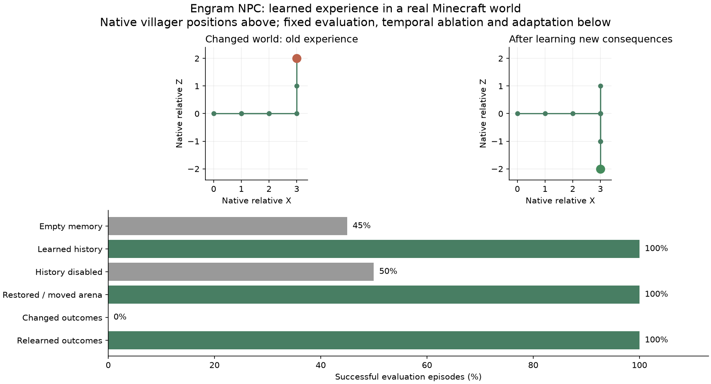

# Minecraft NPC laboratory

The laboratory runs the Python Engram NPC against a real Minecraft 1.21.1 villager in a fresh headless GameTest world. Java supplies native observations and applies actions on the server thread. Python learns, chooses actions, checkpoints and adapts. The game adapter contains no learned policy or hardcoded correct-branch rule.

## Execute

```sh
python tools/npc_lane.py build --work <scratch-directory> --heavy-lock <shared-heavy-lock>
python tools/npc_lane.py run --work <scratch-directory> --heavy-lock <shared-heavy-lock>
```

Use the same atomic heavy-build lock as other Minecraft work on the machine. The runner releases only its own lock and stops only its own subprocess tree on failure. It never targets an existing server, world or unrelated Java process. All worlds, runtime captures, checkpoints, reports and build outputs go into scratch space. `--java` can select the build JDK.

The build uses the pinned Gradle 9.7.1 wrapper, Fabric Loom 1.17.21, Loader 0.19.5, Fabric API 0.116.17+1.21.1, a JDK 25 build launcher and a JDK 21 game toolchain. The wrapper checksum is retained. Dependencies may be resolved on the first build. No production server port, RCON password, local model or model API is involved; the GameTest server opens no normal multiplayer listener.

Defaults run 120 training episodes, 40 evaluation episodes per condition, 120 temporal-ablation training episodes and 40 adaptation episodes, with five planning updates per real action. These are declared experiment work budgets, not caps inside the NPC engine. `--training`, `--evaluation`, `--ablation`, `--adaptation`, `--planning` and `--seed` configure them.

This fixture ends an encounter after forty actions and counts that truncation as failure. The library has no corresponding episode-length limit. The GameTest also has its own tick deadline, independently of the controller's process deadline; incomplete experiments fail rather than silently dropping episodes.

To test a provided environment-tailored seed in another fresh JVM/world:

```sh
python tools/npc_lane.py run --work <scratch-directory> --heavy-lock <shared-heavy-lock> --checkpoint <first-run>/npc.engram --training 0 --ablation 0 --adaptation 0
```

## What the game actually does

A serial GameTest owns a small corridor and T junction. The villager has vanilla autonomous AI and gravity disabled so that the controller owns action selection. Every movement action goes through Minecraft's `Entity.move`, with collision response. Physically available actions come from native bounding-box collision and floor queries.

At the start, a red/blue wool block provides a local cue. The witness hides that cue after leaving its observation location. The two possible endpoint floors are actual emerald and magma blocks. The host derives outcomes from the floor the villager reaches; magma also applies native hot-floor damage. The correct endpoint can be reversed between training phases by changing those blocks. The controller sees only the current witness, available actions and later feedback.

The eight channels are relative corridor progress, locally observed cue, relative side displacement, four native clearance readings, and normalized actual health. The first complex pair combines progress and cue, allowing their temporal relationship to enter K/G. At the junction the current witness is the same for either cue. A control with `dynamics_weight=0` removes that temporal information while retaining the current witness and the same response-learning mechanism.

The host owns action meanings (`east`, `west`, `north`, `south`), movement costs, terminal outcomes and an episode work budget. Those choices are not part of the generic NPC action vocabulary. The example is a controlled delayed-cue learning task rather than a broad test of Minecraft survival or vanilla AI pathfinding.

## The file lane

The mod is inert without `-Dengram.lane` and a fresh `-Dengram.session`. A request is atomically written as `request.json` with a UUID request ID, the session and an operation (`reset`, `observe`, `step` or `finish`). Java validates the session and rejects reused IDs. It processes world work on the server thread and atomically writes `<id>.json` with the same identity.

Responses include game tick, entity UUID, actual native position, witness, available actions, actual floor block, feedback and termination where applicable. A movement acknowledgement also includes actual distance moved. Python requires fresh IDs, advancing ticks, matching operations/session and genuine unit movement for advertised legal actions. An acknowledgement error fails the run.

Three separate native observations prime each encounter's fit. The lane never substitutes a pre-authored observation trace for world queries. Policy action traces, the native acknowledgement stream, a source-hash inventory and the learned checkpoint remain in that run's scratch directory.

History is indexed by ordered decision/observation events. Game ticks advance between acknowledgements but need not be equally spaced. With vanilla AI and gravity disabled, the actor stays under the controller's ownership between commands. This experiment does not claim uniformly sampled physical-time motion forecasting.

The local protocol is a development-world controller, not a remote administration API. It assumes a private scratch lane. No normal player world is modified by the reproduction command.

## Acceptance and receipts

The retained [receipt](../../research/npc/minecraft.json) records one full study and a second fresh JVM/world consuming the first study's actual learned checkpoint. Each evaluation condition has 40 episodes at seed 7:

| Condition | Success | Mean actions |
|---|---:|---:|
| Empty-memory baseline | 18/40 | 18.075 |
| Learned temporal experience | 40/40 | 7 |
| Fitted history disabled | 20/40 | 5 |
| Restored memory, translated arena | 40/40 | 7 |
| Changed endpoint outcomes, before relearning | 0/40 | 7 |
| After 40 relearning episodes | 40/40 | 8 |
| Saved seed in a second fresh world | 40/40 | 7 |

The fresh seeded world also passed translated-arena evaluation. Across both runs the controller received 10,251 behavioral lane acknowledgements and applied 7,691 native movement actions. Both [first](../../research/npc/minecraft-first.xml) and [seeded](../../research/npc/minecraft-seeded.xml) JUnit reports passed. A retained native-observation pair demonstrates identical current junction witnesses after opposite earlier cues, with distinct fitted history. The results establish history-dependent decisions on this task; successful paths still contain backtracking and are not optimal navigation.



This is a schematic generated from captured native coordinates, with fixed axes across the two traces; it is not a Minecraft framebuffer or an artist's proposed behavior.

The runner tests empty-memory behavior, real-game training, frozen evaluation, saved-memory transfer at a translated world origin, disabled fitted history, and changed endpoint outcomes followed by relearning. Policy gates require at least 90% learned and transferred success, a material improvement over the empty baseline, at most 60% success without fitted history, and at least 90% success after adaptation.

A successful Gradle compile is insufficient. Completion requires the behavioral gates **and** an actual nonempty JUnit report without failures/errors. Source hashes must stay unchanged during a run. Captures retain failed runs too; a timeout or incomplete ablation is not a pass.

The lane consumes each request before publishing its acknowledgement. Windows can transiently deny access around rename/publication, so both atomic writes and response reads retry sharing violations within their operation deadline. A malformed response, wrong session, stale tick or native movement mismatch fails rather than becoming synthetic feedback. An interrupted or timed-out run does not establish a behavioral or JUnit pass.

`tools/build_npc_evidence.py <full-run> <seeded-run> --plot` seals the reduced receipt and figure after checking source identities, real JUnit verdicts and the checkpoint link. The optional figure uses matplotlib. Worlds, complete command logs, runtime directories and working NPC memories stay in scratch space; no vocabulary or model weights are added to the repository.

The design follows the isolated server/file-lane approach examined in Tiercel, and the ownership/cleanup patterns in Recon and Somnium. Those repositories are reference consumers and remain unchanged. The Java adapter targets the declared Minecraft/Fabric versions; other loaders and versions require separate compatibility validation.
